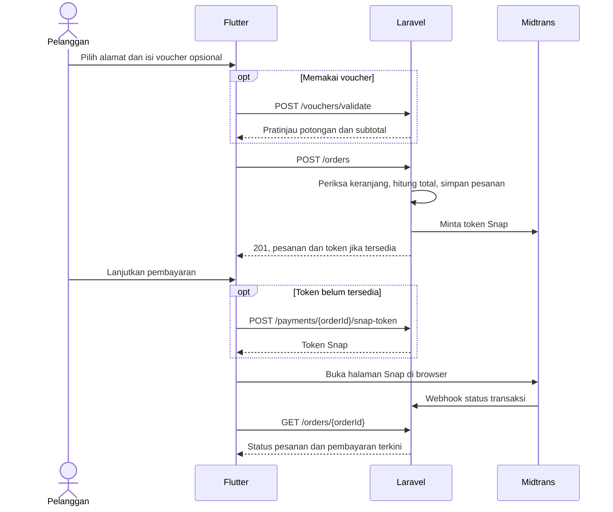

# Alur sistem Flutter dan Laravel

## Startup dan autentikasi

1. Flutter memuat konfigurasi, memulihkan token, lalu Splash memeriksa sesi melalui `GET /auth/me` jika token tersedia.
2. Sesi valid dengan email terverifikasi masuk ke tab utama. Email yang menunggu verifikasi dibawa ke layar OTP. Tanpa sesi atau verifikasi tertunda, Splash membuka Login.
3. Registrasi dan pembaruan email dapat memulai verifikasi. Backend mengirim OTP dan menangani batas percobaan. Reset kata sandi menggunakan OTP terpisah yang ditukar dengan `reset_token`; setelah kata sandi diubah, pelanggan login kembali.
4. Request berikutnya membawa Bearer token melalui interceptor. Logout mencoba mengakhiri sesi Laravel dan membersihkan sesi lokal.

## Checkout dan pembayaran

- `POST /orders` memakai `address_id`, `voucher_code` opsional, dan `notes` opsional. Laravel menghitung stok, harga, promo tanggal, potongan voucher, serta ongkir. Pratinjau voucher tidak memakai kuota.
- Pesanan dapat tersimpan dengan token Snap kosong. Buka detail pesanan yang dikembalikan server dan gunakan aksi pembayaran dari sana. Jika respons checkout terputus, periksa daftar pesanan dan keranjang sebelum mengulangi permintaan agar pelanggan mengetahui apakah pesanan sudah dibuat.
- Saat pengguna kembali dari Snap, detail memuat ulang pesanan. Webhook Midtrans diproses Laravel. Tampilan dapat masih menunjukkan pembayaran pending sampai backend menerima pembaruan.
- Pembatalan pesanan memakai `POST /orders/{id}/cancel`. Jika backend mengembalikan `409`, muat ulang detail sebelum mencoba lagi. Pembayaran terlambat dapat tercatat sukses pada pesanan yang tetap berstatus batal.

## Status pesanan dan pembayaran

| Status pesanan | Perubahan atau tindakan |
| --- | --- |
| `pending_payment` | Pelanggan dapat melanjutkan pembayaran atau meminta pembatalan selama pembayaran belum sukses. |
| `paid` | Backend telah mencatat pembayaran berhasil. Admin dapat memproses pesanan. |
| `processing`, `packing` | Admin memproses dan mengemas pesanan. Flutter menampilkan status server. |
| `shipped` | Admin telah mengirim pesanan. Pelanggan dapat mengonfirmasi penerimaan dengan pembayaran `success`. |
| `completed` | Pesanan selesai. Permintaan konfirmasi yang diulang pada pesanan berbayar ini tetap berhasil di Laravel. |
| `cancelled` | Pesanan batal. Jika pembayaran tercatat `success`, pelanggan dapat mengajukan refund sesuai aturan. |

Status pembayaran dipisahkan dari status pesanan. Kontrak backend mengenal `pending`, `success`, `failed`, dan `expire`.

## Status refund

Syarat pengajuan di aplikasi adalah pembayaran `success`, status pesanan `paid`, `processing`, `packing`, `shipped`, `completed`, atau `cancelled`, serta tidak ada refund aktif atau selesai. Backend memeriksa ulang kepemilikan dan kelayakan, lalu menetapkan nominal.

| Status refund | Tindakan |
| --- | --- |
| `pending` | Admin meninjau bukti. Pelanggan masih dapat membatalkan pengajuan. |
| `approved` | Pengajuan disetujui dan menunggu penyelesaian. |
| `processing` | Refund sedang diproses. Aplikasi menampilkan status yang dikembalikan Laravel. |
| `completed` | Pengembalian dana selesai. |
| `rejected`, `cancelled` | Pelanggan dapat mengajukan ulang jika pesanan tetap memenuhi syarat. |

Laravel dan admin menangani jalur manual maupun Midtrans. Detail pesanan menampilkan ringkasan pengajuan terbaru, sedangkan riwayat refund memuat pengajuan secara terpisah. [Operasional refund backend](https://github.com/sanxnn/rubung-v3/blob/main/docs/refund.md)

## Status custom order

| Status | Tindakan |
| --- | --- |
| `pending_review` | Admin meninjau permintaan. Pelanggan bisa menambah lampiran dan membatalkan. |
| `quoted` | Admin memberi penawaran. Pelanggan dapat menyetujui dengan alamat pengiriman atau membatalkan. |
| `approved` | Backend sudah membuat order terkait. Gunakan `data.id` pesanan hasil persetujuan untuk membuka detail dan melanjutkan pembayaran. |
| `rejected`, `cancelled` | Pengajuan ditutup. Aplikasi menampilkan keputusan dan catatan yang tersedia. |

[Panduan fitur](fitur.md) · [Peta integrasi API](referensi-integrasi-api.md)

## Alamat dan keranjang sebagai prasyarat checkout

1. Form alamat mengambil empat tingkat wilayah. Setiap pilihan menjadi parameter untuk tingkat berikutnya. Kode bertitik seperti `35.09.01` dipakai sebagai string agar nol di depan setiap segmen tetap utuh.
2. Setelah alamat berhasil disimpan, aplikasi dapat memuatnya kembali dan memakai ID alamat untuk checkout atau persetujuan custom order. Checkout memilih alamat utama ketika tersedia dan memungkinkan pelanggan menggantinya.
3. Detail produk dan bundle mengirim ID varian ke endpoint penambahan barang. `GET /cart` dan respons mutasi menentukan isi keranjang yang dilihat pelanggan. Jumlah bisa dipengaruhi perubahan stok dari sisi toko.
4. Laravel memeriksa keranjang saat checkout. Jika stok atau voucher berubah, tampilkan pesan server dan sesuaikan pilihan sebelum mencoba lagi. Setelah checkout berhasil, Flutter meminta ulang keranjang dan membuka detail pesanan yang baru dibuat.

## Batas konsistensi yang perlu diuji

- Konfirmasi penerimaan aman diulang saat pesanan berbayar sudah `completed`. Detail harus tetap menampilkan ringkasan refund setelah operasi.
- Server memproses transaksi pembayaran secara asinkron. Status lokal yang terlihat setelah browser ditutup dapat tertinggal sampai request detail berikutnya.
- Untuk regresi backend custom order, uji persetujuan dan pembatalan dari dua sesi. Pada revisi backend yang diaudit, persetujuan mengunci dan memeriksa ulang baris, sedangkan pembatalan memakai status dari objek yang sudah dimuat. Pemeriksaan ini berasal dari audit kode dan belum diuji dengan dua koneksi. [Controller custom order Laravel](https://github.com/sanxnn/rubung-v3/blob/6044a28/app/Http/Controllers/Api/CustomOrderController.php)
