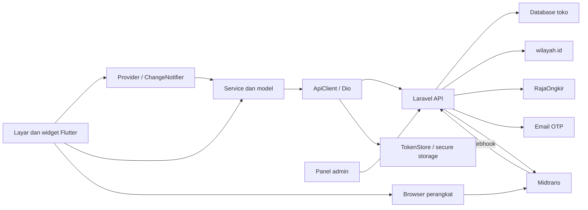

# Arsitektur aplikasi Flutter

Aplikasi Flutter melayani akun pelanggan, katalog, transaksi, pengiriman, refund, dan pesanan custom. Tim toko mengelola katalog, memproses pesanan, meninjau refund, dan memberi penawaran custom melalui panel admin Laravel.

[Indeks dokumentasi](README.md)

## Arsitektur

| Lapisan | Tanggung jawab |
| --- | --- |
| [Startup dan navigasi](../lib/main.dart) | Memuat `.env`, menginisialisasi klien API, menyediakan controller, dan membuka Splash. |
| [Layar](../lib/views), [widget](../lib/widgets), [tema](../lib/theme) | Navigasi, input, validasi awal, dan tampilan status. Tab utama berisi Beranda, Keranjang, Pesanan, dan Profil. |
| [Controller](../lib/controllers) | Controller akun, katalog, bundling, alamat, keranjang, pesanan, dan custom order memakai `ChangeNotifier`. Layar refund menyimpan state operasi di layar dan memanggil service langsung. |
| [Service](../lib/services) dan [model](../lib/models) | Service mengirim request lewat Dio serta membentuk model dari JSON. Model pesanan menurunkan ketersediaan aksi dari status pesanan, pembayaran, dan refund. |
| [Jaringan](../lib/core/network) | Base URL, header, token, path gambar publik, serta pembuka Snap. |
| [Utilitas](../lib/core/utils) | Pemetaan pesan API, hasil operasi, serta pemeriksaan awal format dan ukuran lampiran. |

Alur data umumnya berjalan dari input layar ke controller dan service. Respons API diparsing ke model, lalu state diperbarui untuk merender layar. Harga, stok, ongkir, kuota voucher, hak akses, dan status transaksi divalidasi di Laravel. Detail transaksi mengambil ulang data setelah aksi pelanggan atau setelah kembali dari browser pembayaran.

## Sesi, penyimpanan, dan jaringan

- `TokenStore` menyimpan token Bearer di secure storage perangkat dan memegang salinan di memori untuk request. Saat startup, token lama dari `shared_preferences` dimigrasikan jika diperlukan. Preferensi biasa menyimpan email yang menunggu verifikasi.
- Splash menanyakan `GET /auth/me` jika token tersedia. Hasilnya menentukan apakah pengguna masuk ke Beranda, Login, atau Verifikasi Email. Interceptor menghapus token ketika menerima `401`. Saat sesi habis di tengah penggunaan, layar dapat menampilkan kegagalan request dan pelanggan perlu login kembali.
- Dio menggunakan `Accept: application/json` serta batas koneksi dan waktu tunggu respons 15 detik. Unggahan memakai `multipart/form-data` dengan boundary yang disiapkan Dio.
- Jalur gambar produk dan lampiran custom menggunakan `/api/storage-image/{path}`. Bukti refund diambil sebagai byte melalui service berautentikasi dan ditampilkan dari memori.
- `.env` merupakan aset aplikasi. Simpan URL publik di sana. Kunci Midtrans, kunci RajaOngkir, dan konfigurasi email berada di backend.

[Sumber kontrak dan arsitektur Laravel](https://github.com/sanxnn/rubung-v3/tree/main/docs)

## Navigasi dan kepemilikan state

| Titik masuk | Layar dan state terkait |
| --- | --- |
| `/` | Splash meminta `AuthController` memulihkan sesi. |
| `/login`, `/register`, `/verify-email` | Login, registrasi, dan verifikasi email. Rute verifikasi menerima email sebagai argumen. |
| `/forgot-password`, `/reset-password-otp`, `/reset-password` | Permintaan OTP, penukaran OTP ke token reset, dan formulir kata sandi baru. |
| `/home` | `MainView` mempertahankan empat tab melalui `IndexedStack`. Detail dan formulir dibuka lewat `MaterialPageRoute`. |
| Beranda | `ProductController` menyimpan kategori, filter, dan halaman. `BundleController` menyimpan daftar paket; detail paket punya state pemilihan varian. |
| Keranjang | `CartController` mengganti state dengan snapshot server setelah mutasi. Checkout menyimpan pilihan alamat, catatan, dan pratinjau voucher pada layar. |
| Pesanan | `OrderController` menyimpan halaman riwayat dan operasi pesanan. Detail memuat data terbaru. Layar refund menggunakan `RefundService` untuk pagination, detail, pengajuan, dan bukti. |
| Profil | `AuthController` menyimpan pengguna aktif, `AddressController` menyimpan daftar alamat, dan `CustomOrderController` menyimpan riwayat permintaan custom saat layar terkait dipakai. |

Controller dibuat pada lingkup aplikasi. Logout dari Profil menghapus sesi lokal, keranjang, daftar alamat, dan riwayat pesanan; riwayat custom dimuat ulang saat layar dibuka. Katalog bersifat publik di API. Aplikasi masuk ke tab utama melalui alur autentikasi.

Saat filter katalog berubah, `ProductController` memulai halaman pertama dengan penanda generasi baru. Respons dari generasi sebelumnya diabaikan agar pencarian yang selesai terlambat tidak mengganti hasil terbaru.

## Paket dan aset

| Komponen | Penggunaan |
| --- | --- |
| `provider` dan `ChangeNotifier` | Injeksi controller dan pembaruan state yang diamati layar. |
| `dio` | JSON, interceptor Bearer token, multipart, dan respons byte gambar. |
| `flutter_dotenv` | Membaca `.env` sebelum klien API dibuat. Base URL memiliki fallback production jika kunci tidak tersedia. |
| `flutter_secure_storage`, `shared_preferences` | Token sesi dan preferensi untuk melanjutkan verifikasi email. |
| `file_selector` | Memilih foto bukti atau lampiran lewat pemilih berkas platform. |
| `url_launcher` | Membuka Snap pada browser eksternal di perangkat dan menggunakan mode bawaan pada Web. |
| `assets/images/` | Gambar bawaan Flutter, termasuk banner. Gambar katalog berasal dari API. |

[Manifest Flutter dan daftar dependensi](../pubspec.yaml)
