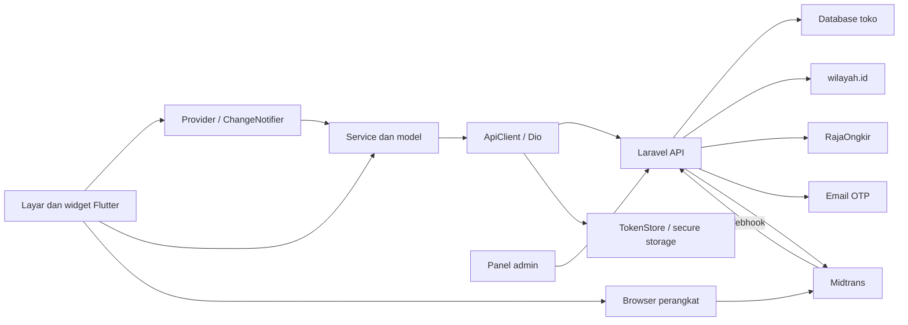

# Dokumentasi aplikasi pelanggan Batik Rubung Kuning

Aplikasi Flutter melayani akun pelanggan, katalog, transaksi, pengiriman, refund, dan pesanan custom. Tim toko mengelola katalog, memproses pesanan, meninjau refund, dan memberi penawaran custom melalui panel admin Laravel.

| Dokumen | Isi |
| --- | --- |
| [Panduan fitur](docs/fitur.md) | Layar, tindakan pelanggan, dan kondisi agar tindakan tersedia. |
| [Alur sistem](docs/alur-sistem.md) | Urutan request, perubahan status, dan pemulihan saat transaksi terganggu. |
| [Peta integrasi API](roadmap.md) | Service Flutter, endpoint yang dipakai, dan cara membaca respons. |
| [Pengembangan, pengujian, dan rilis](docs/pengujian-dan-rilis.md) | Menjalankan aplikasi, menguji alur lokal dan sandbox, serta menyiapkan build. |

## Arsitektur

| Lapisan | Tanggung jawab |
| --- | --- |
| [Startup dan navigasi](lib/main.dart) | Memuat `.env`, menginisialisasi klien API, menyediakan controller, dan membuka Splash. |
| [Layar](lib/views), [widget](lib/widgets), [tema](lib/theme) | Navigasi, input, validasi awal, dan tampilan status. Tab utama berisi Beranda, Keranjang, Pesanan, dan Profil. |
| [Controller](lib/controllers) | Controller akun, katalog, bundling, alamat, keranjang, pesanan, dan custom order memakai `ChangeNotifier`. Layar refund menyimpan state operasi di layar dan memanggil service langsung. |
| [Service](lib/services) dan [model](lib/models) | Service mengirim request lewat Dio serta membentuk model dari JSON. Model pesanan menurunkan ketersediaan aksi dari status pesanan, pembayaran, dan refund. |
| [Jaringan](lib/core/network) | Base URL, header, token, path gambar publik, serta pembuka Snap. |
| [Utilitas](lib/core/utils) | Pemetaan pesan API, hasil operasi, serta pemeriksaan awal format dan ukuran lampiran. |

Alur data umumnya berjalan dari input layar ke controller dan service. Respons API diparsing ke model, lalu state diperbarui untuk merender layar. Harga, stok, ongkir, kuota voucher, hak akses, dan status transaksi divalidasi di Laravel. Detail transaksi mengambil ulang data setelah aksi pelanggan atau setelah kembali dari browser pembayaran.

## Sesi, penyimpanan, dan jaringan

- `TokenStore` menyimpan token Bearer di secure storage perangkat dan memegang salinan di memori untuk request. Saat startup, token lama dari `shared_preferences` dimigrasikan jika diperlukan. Preferensi biasa menyimpan email yang menunggu verifikasi.
- Splash menanyakan `GET /auth/me` jika token tersedia. Hasilnya menentukan apakah pengguna masuk ke Beranda, Login, atau Verifikasi Email. Interceptor menghapus token ketika menerima `401`. Saat sesi habis di tengah penggunaan, layar dapat menampilkan kegagalan request dan pelanggan perlu login kembali.
- Dio menggunakan `Accept: application/json` serta batas koneksi dan waktu tunggu respons 15 detik. Unggahan memakai `multipart/form-data` dengan boundary yang disiapkan Dio.
- Jalur gambar produk dan lampiran custom menggunakan `/api/storage-image/{path}`. Bukti refund diambil sebagai byte melalui service berautentikasi dan ditampilkan dari memori.
- `.env` merupakan aset aplikasi. Simpan URL publik di sana. Kunci Midtrans, kunci RajaOngkir, dan konfigurasi email berada di backend.

[Sumber kontrak dan arsitektur Laravel](https://github.com/sanxnn/rubung-v3/tree/main/docs)
